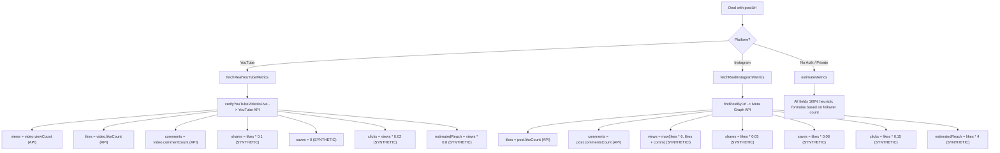
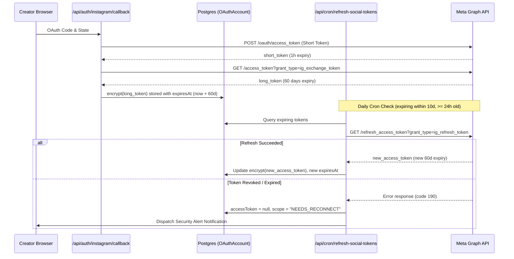
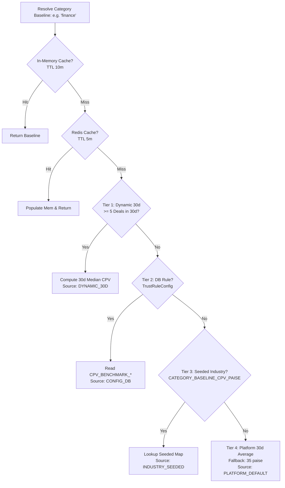

# Analytics, Pricing & Telemetry Architecture Specification (v3)

> **Document Status**: Complete Engineering Audit & Architecture Specification  
> **Repository Target**: `vyaparmedia`  
> **Specification ID**: `docs/design/analytics-pricing-v3.md`  
> **Date**: November 22, 2026  
> **Author**: Antigravity Principal System Architect  
> **Notice**: Read-only Architectural Analysis. No schema or application source code modified.

---

## Table of Contents
1. [Executive Summary & High-Risk Findings](#1-executive-summary--high-risk-findings)
2. [Data Classification Matrix (Schema Field-Level Audit)](#2-data-classification-matrix-schema-field-level-audit)
3. [End-to-End Telemetry Ingest & Engagement Tracker Analysis](#3-end-to-end-telemetry-ingest--engagement-tracker-analysis)
4. [Social OAuth Lifecycle, Token Encryption & Reconnect Plumbing](#4-social-oauth-lifecycle-token-encryption--reconnect-plumbing)
5. [Matching Engine, CPV Pricing & Mathematical Inversion Analysis](#5-matching-engine-cpv-pricing--mathematical-inversion-analysis)
6. [Financial Reports, Print Engine & PDF Export Plumbing](#6-financial-reports-print-engine--pdf-export-plumbing)
7. [Auth, Security, Rate Limiting & Edge WAF Plumbing](#7-auth-security-rate-limiting--edge-waf-plumbing)
8. [Operational Kill-Switches vs. Feature Flagging Architecture](#8-operational-kill-switches-vs-feature-flagging-architecture)
9. [Regulatory Compliance, ASCI/CCPA & Privacy Consent Audit](#9-regulatory-compliance-ascicpa--privacy-consent-audit)
10. [Background Jobs, QStash Synchronization & Cron Guards](#10-background-jobs-qstash-synchronization--cron-guards)
11. [Dashboard Analytics, N+1 Query Traps & Database Index Analysis](#11-dashboard-analytics-n1-query-traps--database-index-analysis)
12. [Consolidated Bug List with Exact Evidence](#12-consolidated-bug-list-with-exact-evidence)
13. [Recommended Remediation & Implementation Order](#13-recommended-remediation--implementation-order)
14. [Open Questions for the Founder](#14-open-questions-for-the-founder)

---

## 1. Executive Summary & High-Risk Findings

This document establishes the canonical technical audit and architecture roadmap for the analytics, pricing, and telemetry subsystems of VyaparMedia. 

### Critical Architecture Flaws Identified

```
+---------------------------------------------------------------------------------------------------+
| CRITICAL DISCREPANCY: Pricing & Telemetry Metric Mismatch                                         |
+---------------------------------------------------------------------------------------------------+
| 1. ESTIMATED VIEWS INVERSION IN MATCHING SERVICE                                                  |
|    estimatedViews = authenticReach * (blendedER / 100)                                            |
|    -> Conflates VIEWS with ENGAGEMENTS (Likes + Comments). For 100k followers with 2.5% ER,           |
|       this yields 2,125 views instead of ~25,000 views.                                           |
|    -> Results in a 10x-30x inflated CPV (e.g. ₹9.41/view instead of ₹0.80/view).                 |
|    -> Unfairly punishes creators with rock-bottom ROI scores (10/100) against category baselines.  |
+---------------------------------------------------------------------------------------------------+
| 2. SYNTHETIC "VERIFIED" INSTAGRAM METRICS                                                         |
|    Instagram Graph API Basic Display / Instagram Login does not provide media view counts.        |
|    fetchRealInstagramMetrics synthesizes views = Math.max(likes * 6, likes + comments)            |
|    and shares, saves, clicks, reach as hardcoded multiples of likes, yet writes isEstimated: false|
|    into EngagementSnapshot!                                                                       |
+---------------------------------------------------------------------------------------------------+
| 3. ROI REPORT N+1 WATERFALL                                                                       |
|    src/app/api/reports/brand/campaign/[id]/roi/route.ts calls                                     |
|    MatchingService.calculateMatchScore for each deal without passing preloaded historical         |
|    engagement or quality scores, executing 3 uncached DB queries per deal in Promise.all!         |
+---------------------------------------------------------------------------------------------------+
| 4. OAUTH SCOPE FIELD OVERLOADING                                                                  |
|    OAuthAccount.scope is overloaded to store transient operational states:                        |
|    "NEEDS_RECONNECT" and "PENDING_APPROVAL", obliterating the original granted OAuth scopes.      |
+---------------------------------------------------------------------------------------------------+
| 5. ABSENCE OF SERVER-SIDE PDF GENERATION                                                          |
|    No PDF library exists. "PDF Export" relies exclusively on window.print() and CSS media print.  |
+---------------------------------------------------------------------------------------------------+
```

---

## 2. Data Classification Matrix (Schema Field-Level Audit)

Every data attribute presented across VyaparMedia UI cards, reports, and dashboards carries a specific epistemic tier:
- **`VERIFIED`**: Sourced directly from immutable external APIs (Meta Graph API, YouTube Data API v3, DigiLocker, Surepass, Razorpay webhooks, Shiprocket tracking).
- **`SELF_REPORTED`**: Input directly by brand or creator without independent cryptographic verification.
- **`DERIVED`**: Computed deterministically via pure backend algorithms, rollup jobs, or statistical heuristics.

Below is the exhaustive classification for the 12 core schema entities in `prisma/schema.prisma`:

### 2.1 `InfluencerProfile` (`prisma/schema.prisma:227-300`)
| Field Name | Type | Classification | Source / Mechanism |
| :--- | :--- | :--- | :--- |
| `id`, `userId` | `String` | **DERIVED** | System cuid generator (`prisma/schema.prisma:228-229`) |
| `displayName` | `String` | **SELF_REPORTED** | Creator input via settings form (`src/app/api/settings/route.ts:16`) |
| `bio`, `avatar` | `String?` | **SELF_REPORTED** | Creator input / CDN upload |
| `city`, `state`, `address`, `pinCode` | `String?` | **SELF_REPORTED** | Creator profile delivery address input |
| `gender`, `age` | `String?`, `Int?` | **SELF_REPORTED** | Creator demographic declaration |
| `instagramHandle` | `String?` | **SELF_REPORTED** (until OAuth link) | User-entered or synced via OAuth callback (`src/app/api/auth/instagram/callback/route.ts:79`) |
| `instagramFollowers` | `Int?` | **VERIFIED** (when OAuth active) | Synced from `getInstagramProfile` (`src/lib/instagram.ts:395`). Resets to 0 if handle edited manually (`src/app/api/settings/route.ts:346`) |
| `instagramEngagementRate`| `Float?` | **DERIVED** | Basis points calculated from average likes/comments over media samples (`src/services/creator-audit.service.ts`) |
| `youtubeHandle` | `String?` | **SELF_REPORTED** (until OAuth link) | User-entered or synced via OAuth callback (`src/app/api/auth/youtube/callback/route.ts`) |
| `youtubeSubscribers` | `Int?` | **VERIFIED** (when OAuth active) | Synced via YouTube Data API v3 channel statistics |
| `youtubeEngagementRate` | `Float?` | **DERIVED** | Basis points calculated from recent video statistics |
| `categories`, `languages`| `String` | **SELF_REPORTED** | Comma-separated niches selected by creator |
| `minRate`, `maxRate` | `Int?` | **SELF_REPORTED** | Rate card bounds in paise |
| `minInstagramRate`, etc.| `Int?` | **SELF_REPORTED** | Platform-specific rate card bounds in paise |
| `followerAuthenticityScore`| `Int` | **DERIVED** | Rule-based DRS calculation (0-100) (`src/lib/drs-score.ts`) |
| `contentQualityScore` | `Int` | **DERIVED** | Review ratings and deliverable dispute history |
| `accountAge` | `DateTime?` | **VERIFIED** | API registration timestamp from Meta / Google |
| `isFeatured`, `featuredUntil`| `Boolean`, `DateTime?`| **DERIVED** | Awarded automatically by gamification challenge service (`src/lib/gamification/`) |
| `totalDeals`, `completedDeals`| `Int` | **DERIVED** | Aggregated deal lifecycle counters |
| `averageRating` | `Int` | **DERIVED** | 0-500 scale computed from approved client `Review` records |
| `totalEarnings`, `totalReviews`| `Int` | **DERIVED** | Escrow settlement aggregations |

### 2.2 `BrandProfile` (`prisma/schema.prisma:302-330`)
| Field Name | Type | Classification | Source / Mechanism |
| :--- | :--- | :--- | :--- |
| `companyName`, `logo`, `website` | `String` | **SELF_REPORTED** | Brand onboarding form |
| `description`, `industry` | `String?` | **SELF_REPORTED** | Brand profile declaration |
| `city`, `state`, `address`, `pinCode` | `String?` | **SELF_REPORTED** | Physical business headquarters |
| `gstNumber`, `panNumber`, `cinNumber`| `String?` | **SELF_REPORTED** (Encrypted) | Symmetric AES-256 encrypted fields (`@encrypted`) |
| `isGstVerified` | `Boolean` | **VERIFIED** | Surepass / GST Portal API sandbox confirmation |
| `isPanVerified` | `Boolean` | **VERIFIED** | NSDL / Surepass PAN verification response |
| `isCinVerified` | `Boolean` | **VERIFIED** | MCA corporate registry lookup |
| `totalCampaigns`, `totalSpent` | `Int` | **DERIVED** | Campaign ledger aggregates in paise |

### 2.3 `Campaign` (`prisma/schema.prisma:499-574`)
| Field Name | Type | Classification | Source / Mechanism |
| :--- | :--- | :--- | :--- |
| `title`, `description`, `guidelines` | `String` | **SELF_REPORTED** | Brand campaign wizard input |
| `totalBudget`, `perInfluencerBudget` | `Int` | **SELF_REPORTED** | Escrow allocation in paise |
| `fundedAmount`, `reservedTotalAmount` | `Int` | **DERIVED** / **VERIFIED** | Razorpay funded wallet escrow reservation |
| `targetCategories`, `targetCities` | `String[]` | **SELF_REPORTED** | Campaign targeting criteria |
| `minFollowers`, `minEngagementRate` | `Int` | **SELF_REPORTED** | Creator eligibility gates |
| `deliverables` | `Json` | **SELF_REPORTED** | Array of `{type, count, specs}` |
| `requiresProduct`, `productValue` | `Boolean`, `Int?` | **SELF_REPORTED** | Physical sample requirements |
| `applicationDeadline`, `postingDeadline` | `DateTime` | **SELF_REPORTED** | Campaign timeline SLAs |
| `status` | `CampaignStatus` | **DERIVED** | State machine managed by services and cron jobs |

### 2.4 `Application` (`prisma/schema.prisma:587-615`)
| Field Name | Type | Classification | Source / Mechanism |
| :--- | :--- | :--- | :--- |
| `proposal` | `String` | **SELF_REPORTED** | Creator pitch text |
| `proposedRate` | `Int` | **SELF_REPORTED** | Bid in paise |
| `estimatedDelivery` | `DateTime?` | **SELF_REPORTED** | Creator promised turnaround |
| `status`, `rejectionReason` | `ApplicationStatus`, `String?` | **DERIVED** | Brand review decision |

### 2.5 `Deal` (`prisma/schema.prisma:641-780`)
| Field Name | Type | Classification | Source / Mechanism |
| :--- | :--- | :--- | :--- |
| `amount`, `platformFee`, `gatewayFee` | `Int` | **DERIVED** | Computed contract terms in paise (`src/lib/deal-calculator.ts`) |
| `tdsDeducted`, `grossPayout`, `netPayout` | `Int` | **DERIVED** | Section 194-O statutory tax deduction in paise |
| `contractTerms` | `Json` | **DERIVED** | Generated contract JSON snapshot (`src/lib/contract-engine.ts`) |
| `contractSignature` | `Json?` | **VERIFIED** | Cryptographic audit trail (SHA-256, IP, timestamp, session ID) |
| `shippingAddress` | `Json?` | **SELF_REPORTED** | Creator delivery coordinates |
| `shippingAwbCode`, `shippingStatus` | `String?` | **VERIFIED** | Shiprocket API webhooks (`src/services/shiprocket.service.ts`) |
| `shippingChargeAmount` | `Int?` | **VERIFIED** | Courier charge billed to brand wallet in paise |
| `postUrl` | `String?` | **SELF_REPORTED** | Live promotional link submitted by creator |
| `requiresPostVerification` | `Boolean` | **DERIVED** | Platform policy enforcement rule |
| `verifiedAt`, `verificationScreenshot` | `DateTime?`, `String?` | **VERIFIED** | Crawler screenshot & media verification |
| `verificationHash` | `String?` | **VERIFIED** | SHA-256 payload integrity hash |
| `isPostAlive`, `lastPostCheck` | `Boolean`, `DateTime?` | **VERIFIED** | Periodic crawler post-alive verification checks |
| `status` | `DealStatus` | **DERIVED** | Canonical deal lifecycle state |

### 2.6 `ContentSubmission` (`prisma/schema.prisma:782-798`)
| Field Name | Type | Classification | Source / Mechanism |
| :--- | :--- | :--- | :--- |
| `contentUrl`, `contentUrls`, `notes` | `String`, `Json?` | **SELF_REPORTED** | Creator file upload URLs & remarks |
| `version`, `status`, `feedback` | `Int`, `String`, `String?` | **DERIVED** | Review workflow state (`PENDING`, `APPROVED`, `REVISION_REQUESTED`) |

### 2.7 `EngagementSnapshot` (`prisma/schema.prisma:1340-1371`)
| Field Name | Type | Classification | Source / Mechanism |
| :--- | :--- | :--- | :--- |
| `interval` | `String` | **DERIVED** | Bucket identifier (`'24h'`, `'48h'`, `'7d'`) |
| `views` | `Int` | **VERIFIED** (YouTube) / **SYNTHETIC** (Instagram) | YouTube: API `viewCount`. Instagram: Synthetic `Math.max(likes * 6, likes + comments)` |
| `likes`, `comments` | `Int` | **VERIFIED** | Sourced directly from YouTube / Instagram API |
| `shares`, `saves`, `clicks` | `Int` | **SYNTHETIC** | Multipliers of likes/views (no platform API provides private saves/shares/clicks) |
| `engagementRate`, `clickThroughRate` | `Int` | **DERIVED** | Basis points computed from interactions |
| `estimatedReach` | `Int` | **SYNTHETIC** | Multiplier of views/likes |
| `isEstimated` | `Boolean` | **DERIVED** | Flag intended to indicate heuristic fallback, but misreported as `false` for Instagram! |

### 2.8 `OAuthAccount` (`prisma/schema.prisma:155-171`)
| Field Name | Type | Classification | Source / Mechanism |
| :--- | :--- | :--- | :--- |
| `provider`, `providerAccountId` | `String` | **VERIFIED** | Unique OAuth provider subject ID |
| `accessToken`, `refreshToken` | `String?` | **VERIFIED** (Encrypted) | Sourced via token exchange, encrypted with AES-256-GCM |
| `expiresAt` | `DateTime?` | **VERIFIED** | Token expiration timestamp returned by OAuth token endpoint |
| `scope` | `String?` | **OVERLOADED** | Stores granted permissions (`"instagram_business_basic"`) OR system state markers (`"NEEDS_RECONNECT"`, `"PENDING_APPROVAL"`) |

### 2.9 `TrustRuleConfig` (`prisma/schema.prisma:466-478`)
| Field Name | Type | Classification | Source / Mechanism |
| :--- | :--- | :--- | :--- |
| `ruleKey`, `category`, `weight` | `String`, `Float` | **VERIFIED** / Admin-Seeded | Authoritative platform configuration for benchmarks and DRS |

### 2.10 `ActivityLog` & `AuditLog` (`prisma/schema.prisma:1187-1222`)
| Field Name | Type | Classification | Source / Mechanism |
| :--- | :--- | :--- | :--- |
| `ActivityLog.*` | Various | **DERIVED** / Telemetry | System event logs with PII masking (`src/lib/audit.ts`) |
| `AuditLog.*` | Various | **VERIFIED** / Immutable | DB-trigger protected (`trg_immutable_audit_log`), append-only administrative records |

### 2.11 `DrsScoreSnapshot` (`prisma/schema.prisma:1577-1597`)
| Field Name | Type | Classification | Source / Mechanism |
| :--- | :--- | :--- | :--- |
| `previousScore`, `calculatedScore`, `finalScore` | `Int` | **DERIVED** | Velocity-capped trust engine score transitions (`src/lib/drs-score.ts`) |

---

## 3. End-to-End Telemetry Ingest & Engagement Tracker Analysis

### 3.1 Field-by-Field Source & Fabrication Analysis (`src/lib/engagement-tracker.ts`)

`src/lib/engagement-tracker.ts` is responsible for capturing engagement metrics for deals at `24h`, `48h`, and `7d` post-publication. An audit of `fetchRealYouTubeMetrics` (L58-92) and `fetchRealInstagramMetrics` (L94-130) reveals significant synthetic fabrication:



#### Detailed Metrics Source Breakdown

| Metric | YouTube Capture (`fetchRealYouTubeMetrics`) | Instagram Capture (`fetchRealInstagramMetrics`) | Fallback Engine (`estimateMetrics`) |
| :--- | :--- | :--- | :--- |
| **`views`** | **API-SOURCED** (`video.viewCount`) | <span style="color:red">**SYNTHETIC**</span>: `Math.max(likes * 6, likes + comments)` (L105) | **SYNTHETIC**: `followers * reachMult * 1.3` (L255) |
| **`likes`** | **API-SOURCED** (`video.likeCount`) | **API-SOURCED** (`post.likeCount`) | **SYNTHETIC**: `totalEngagements * 0.70` (L259) |
| **`comments`** | **API-SOURCED** (`video.commentCount`) | **API-SOURCED** (`post.commentsCount`) | **SYNTHETIC**: `totalEngagements * 0.10` (L260) |
| **`shares`** | <span style="color:red">**SYNTHETIC**</span>: `Math.round(likes * 0.1)` (L69) | <span style="color:red">**SYNTHETIC**</span>: `Math.round(likes * 0.05)` (L106) | **SYNTHETIC**: `totalEngagements * 0.08` (L261) |
| **`saves`** | <span style="color:red">**SYNTHETIC**</span>: Hardcoded `0` (L70) | <span style="color:red">**SYNTHETIC**</span>: `Math.round(likes * 0.08)` (L107) | **SYNTHETIC**: `totalEngagements * 0.12` (L262) |
| **`clicks`** | <span style="color:red">**SYNTHETIC**</span>: `Math.round(views * 0.02)` (L71) | <span style="color:red">**SYNTHETIC**</span>: `Math.round(likes * 0.15)` (L108) | **SYNTHETIC**: `Math.round(views * 0.02)` (L265) |
| **`estimatedReach`**| <span style="color:red">**SYNTHETIC**</span>: `Math.round(views * 0.8)` (L85) | <span style="color:red">**SYNTHETIC**</span>: `Math.round(likes * 4)` (L122) | **SYNTHETIC**: `followers * reachMult` (L252) |
| **`isEstimated` DB Flag**| Written as `false` (L211, L222) | <span style="color:red">**Written as `false` (L211, L222)**</span> | Written as `true` (L211, L222) |

> [!CAUTION]
> **Data Integrity Violation**: In `fetchRealInstagramMetrics`, `views` is 100% synthetic (`likes * 6`). Yet in `captureEngagement` (L211-222), `isEstimated` is marked `false` whenever `fetchRealInstagramMetrics` returns a non-null object! This violates the platform's core correctness invariant: *"Every number shown to a user carries data quality: 'VERIFIED' | 'ESTIMATED' | 'SELF_REPORTED'. Never display estimated or derived data as measured."*

### 3.2 Full Graph of `EngagementSnapshot` Consumers

Grep search across `src` identifies the following consumers of `EngagementSnapshot`:

1. **ROI Report API Handler** (`src/app/api/reports/brand/campaign/[id]/roi/route.ts:24, 59-62`):
   - Reads `deal.engagementSnapshots` ordered by `capturedAt DESC`. Selects the most mature snapshot (`7d` -> `48h` -> `24h` -> index 0).
   - Computes delivered views, reach, CPV, CPE, CPR, and prediction accuracy.
2. **Deal Detail Engagement Route** (`src/app/api/deals/[id]/engagement/route.ts:10, 65, 120`):
   - Directly calls `getEngagementReport` to serve JSON telemetry to the deal workspace.
3. **Engagement Tracker Batch Cron** (`src/app/api/cron/engagement/route.ts:4, 23`):
   - Triggers `batchCaptureEngagement()` every 4 hours (`0 */4 * * *`) for active deals within the 8-day window.
4. **Deal Engagement UI Card** (`src/components/dashboard/deals/EngagementCard.tsx:7, 57`):
   - Displays snapshot metrics, engagement breakdown, and ROI badge (`DealDetailHelpers.tsx:121, 145`).
5. **Brand Gamification Badges** (`src/lib/gamification/badges-brands.ts:31, 42-45`):
   - Queries `deal.engagementSnapshots` to sum verified views and reach for unlocking brand achievement badges (*"Audience Magnet"*, *"Reach Titan"*).
6. **Creator Streak Badges** (`src/lib/gamification/badges-streaks.ts:141`):
   - Counts deals where `engagementSnapshots.views >= 1000` to verify performance milestones.
7. **Matching Engine Dynamic 30-Day Category CPV Baseline** (`src/services/matching.service.ts:110-128`):
   - Queries completed deals from the past 30 days and reads `engagementSnapshots[0].views` (if views >= 100) to compute median category CPV.
8. **Matching Engine Overall Platform Average CPV** (`src/services/matching.service.ts:199-217`):
   - Queries all completed deals from the past 30 days and reads `engagementSnapshots[0].views` to calculate platform fallback CPV.
9. **Matching Engine Historical Creator Engagement Rate** (`src/services/matching.service.ts:573-615`):
   - In `batchGetHistoricalEngagementRates`, queries all snapshots for the creator's past deals to compute `(likes + comments + shares + saves) / views`.
10. **Notable Absences**:
    - `src/lib/analytics-engine.ts` **DOES NOT** read `EngagementSnapshot`. It reads only `Deal.amount` and profile counters.
    - `src/services/admin-analytics.service.ts` **DOES NOT** read `EngagementSnapshot`. Admin GMV and revenue are calculated exclusively from `Deal` and `Transaction` tables.

---

## 4. Social OAuth Lifecycle, Token Encryption & Reconnect Plumbing

### 4.1 OAuth Scope Definition & Meta App Review Boundary (`src/lib/instagram.ts`)

- **Configured Scopes**: `instagram_business_basic` (`src/lib/instagram.ts:106`).
- **Scope Limitation**: Meta requires **Meta App Review** and Business Verification to grant `instagram_business_manage_insights` (which provides media insights like actual impressions, reach, and video views).
- Because Meta App Review is held pending launch approval, VyaparMedia is restricted to `instagram_business_basic`. Under this scope, Meta Graph API (`/me/media?fields=...`) returns only:
  `id, media_type, media_url, permalink, caption, timestamp, like_count, comments_count`.
- **View counts are completely unavailable from the API for regular posts and reels under basic scope.** This explains why `fetchRealInstagramMetrics` was forced to estimate `views = likes * 6`.

### 4.2 Token Encryption & Refresh Pipeline



1. **Encryption Standard**:
   - Implemented via `@/lib/encryption` (`src/lib/encryption.ts`).
   - Uses **AES-256-GCM** with authenticated encryption tags.
   - Requires `TOKEN_ENCRYPTION_KEY` (must be 32 bytes hex/base64).
   - Plaintext tokens are never stored in the database.
2. **On-Read Token Freshness Guard (`getFreshInstagramAccessToken`, L300-357)**:
   - When a caller requests a token, if `expiresAt <= now + 5 minutes`, it proactively decrypts and calls `refreshInstagramToken`.
   - If refresh succeeds, the database is updated with the new encrypted token and extended expiry.
   - If refresh fails, it marks `scope = "NEEDS_RECONNECT"` and returns `null`.
3. **Scheduled Refresh Cron (`src/app/api/cron/refresh-social-tokens/route.ts`)**:
   - Protected by distributed Redis lock `cron:refresh-social-tokens:lock` (120s TTL).
   - Queries `OAuthAccount` where `expiresAt <= now + 10 days`, `expiresAt > now`, and `updatedAt <= now - 24 hours` (Meta API enforces that tokens can only be refreshed if at least 24 hours old).
   - On failure, calls `markAccountNeedsReconnect(accountId, userId, provider)`.

### 4.3 The `NEEDS_RECONNECT` Marker & Scope Overloading Flaw

In `src/app/api/cron/refresh-social-tokens/route.ts:137-165` and `src/app/api/settings/route.ts:246-263`:
```typescript
// src/app/api/cron/refresh-social-tokens/route.ts:139-145
await prisma.oAuthAccount.update({
  where: { id: accountId },
  data: {
    accessToken: null,
    scope: "NEEDS_RECONNECT",
  },
});
```
```typescript
// src/app/api/settings/route.ts:247-254
socialConnections: {
  instagram: {
    connected: !!instagramOAuth && instagramOAuth.scope !== "NEEDS_RECONNECT",
    accessTokenPresent: !!instagramOAuth?.accessToken,
    needsReconnect: instagramOAuth?.scope === "NEEDS_RECONNECT",
    pendingApproval: instagramOAuth?.scope === "PENDING_APPROVAL",
    lastSynced: instagramOAuth?.updatedAt?.toISOString() || null,
    handle: profileData.instagramHandle || null,
  },
}
```

> [!WARNING]
> **Anti-Pattern (Scope Column Overloading)**:
> In `prisma/schema.prisma:163`, `scope` is typed `String?`. Instead of adding a dedicated `status` enum column (e.g. `OAuthStatus: ACTIVE | EXPIRED | NEEDS_RECONNECT | REVOKED`), the codebase mutates `scope` to `"NEEDS_RECONNECT"` or `"PENDING_APPROVAL"`. When this occurs, the actual granted OAuth scopes (e.g. `instagram_business_basic,pages_show_list`) are permanently erased and replaced by a status string!

---

## 5. Matching Engine, CPV Pricing & Mathematical Inversion Analysis

### 5.1 Category Baseline Resolution Hierarchy (`src/services/matching.service.ts:250-320`)

The baseline CPV (Cost Per View) in paise for campaign categories is resolved through a strict 4-tier hierarchy:



- **Tier 1 (Dynamic 30-Day Platform Historical Data)**:
  - Queries deals from past 30 days in the target category (`status IN ['VERIFIED', 'COMPLETED', 'POSTED']`, `amount > 0`).
  - Reads `engagementSnapshots[0].views`. Filters `views >= 100`.
  - Calculates `dealCpv = deal.amount / views`.
  - If `validCpvs.length >= 5`, returns the median CPV.
- **Tier 2 (Database Configured Rule)**:
  - Looks up `TrustRuleConfig` where `ruleKey = 'CPV_BENCHMARK_' + normalizedCategory`. Admin-configurable without code deployment.
- **Tier 3 (Pre-seeded Industry Reference)**:
  - Loaded from `CATEGORY_BASELINE_CPV_PAISE` in `src/lib/roi-calculator.ts:6-34`:
    - Finance: **120 paise** (₹1.20)
    - Business: **100 paise** (₹1.00)
    - Tech: **65 paise** (₹0.65)
    - Fitness: **40 paise** (₹0.40)
    - Travel: **35 paise** (₹0.35)
    - Fashion: **25 paise** (₹0.25)
    - Gaming / Entertainment: **15-18 paise** (₹0.15 - ₹0.18)
- **Tier 4 (Low-Data Platform Default Fallback)**:
  - Overall platform 30-day median CPV via `getOverallPlatformAverageCpv()`, defaulting to `DEFAULT_BASELINE_CPV_PAISE = 35` (₹0.35).

#### Cache TTL Matrix
- `categoryBaselineMemoryCache`: **10 minutes** (`now + 10 * 60 * 1000`)
- `dynamicBaselineMemoryCache`: **10 minutes** (`now + 10 * 60 * 1000`)
- `dbConfiguredMemoryCache`: **10 minutes** (`now + 10 * 60 * 1000`)
- `platformAvgMemoryCache`: **15 minutes** (`now + 15 * 60 * 1000`)
- Redis Key `category_cpv:resolved:${normalized}`: **300 seconds (5 minutes)**

---

### 5.2 The `estimatedViews` Mathematical Inversion Bug (~L796-798)

Look at the implementation in `src/services/matching.service.ts:796-798`:
```typescript
const authenticReach = totalFollowers * (authenticityScore / 100);
const estimatedViews = Math.max(10, Math.round(authenticReach * (blendedER / 100)));
const cpvPaise = activeCostPaise / estimatedViews;
```

#### The Mathematical Flaw
In influencer marketing:
$$\text{Authentic Reach} = \text{Followers} \times \text{Authenticity Rate}$$
$$\text{Total Engagements (Likes + Comments)} = \text{Authentic Reach} \times \text{Engagement Rate}$$
$$\text{Delivered Views (Impressions)} = \text{Authentic Reach} \times \text{View Ratio (typically 20\% to 60\% of followers)}$$

The code multiplies `authenticReach` by `blendedER / 100` and labels the result **`estimatedViews`**!
Because Engagement Rate is typically 1.5% to 5.0%, multiplying reach by ER calculates **TOTAL ENGAGEMENTS (Interactions)**, not views!
Consequently, `estimatedViews` is understated by a factor of **10x to 30x**. When `activeCostPaise` is divided by this tiny number, `cpvPaise` is grossly overstated by 10x to 30x, destroying the creator's relative ROI score!

---

### 5.3 Hand-Derived Re-Derivations for 3 Personas

#### Persona A: Nano-Influencer (Fashion)
- **Profile**: 10,000 Instagram followers, `authenticityScore = 80%`, `blendedER = 4.00%` (400 basis points).
- **Deal Quote**: ₹3,000 (300,000 paise).
- **Industry Fashion Baseline CPV**: **25 paise** (₹0.25).

**Formula in Code (`MatchingService.ts:796-798`)**:
1. `authenticReach` = $10,000 \times 0.80 = 8,000$
2. `estimatedViews` = $\text{round}(8,000 \times (4.0 / 100)) = \mathbf{320\text{ views}}$
3. `cpvPaise` = $300,000 / 320 = \mathbf{937.5\text{ paise (₹9.38 per view)}}$
4. Efficiency Ratio = $\text{cpvPaise} / \text{baseline} = 937.5 / 25 = \mathbf{37.5\times}$
5. `calculateRoiScore(937.5, 25)`: Since ratio > 3.5, score is clamped to **`10 / 100`** (Worst Possible / Substantially Overpriced).

**Reality in Market**:
- A 10k fashion creator with 80% authentic followers generates ~2,500 views on a Reel (25% reach).
- Real CPV = $300,000 / 2,500 = \mathbf{120\text{ paise (₹1.20)}}$.
- Real Efficiency Ratio = $120 / 25 = 4.8\times$. Still premium, but the algorithm calculated 37.5x!

---

#### Persona B: Mid-Tier Creator (Tech)
- **Profile**: 100,000 Instagram followers, `authenticityScore = 85%`, `blendedER = 2.50%` (250 basis points).
- **Deal Quote**: ₹20,000 (2,000,000 paise).
- **Industry Tech Baseline CPV**: **65 paise** (₹0.65).

**Formula in Code (`MatchingService.ts:796-798`)**:
1. `authenticReach` = $100,000 \times 0.85 = 85,000$
2. `estimatedViews` = $\text{round}(85,000 \times (2.5 / 100)) = \mathbf{2,125\text{ views}}$
3. `cpvPaise` = $2,000,000 / 2,125 = \mathbf{941.17\text{ paise (₹9.41 per view)}}$
4. Efficiency Ratio = $941.17 / 65 = \mathbf{14.48\times}$
5. `calculateRoiScore(941.17, 65)`: Ratio > 3.5, score clamped to **`10 / 100`**.

**Reality in Market**:
- A 100k tech creator delivers ~25,000 Reel/Video views (25% reach).
- Real CPV = $2,000,000 / 25,000 = \mathbf{80\text{ paise (₹0.80)}}$.
- Real Efficiency Ratio = $80 / 65 = \mathbf{1.23\times}$ (Fair Market Price / Slight Premium).
- Fair Market ROI Score (`calculateRoiScorePure`, L107-111):
  $$\text{Score} = 50 + \frac{2.0 - 1.23}{0.8} \times 20 \approx \mathbf{69 / 100}$$
- **Result**: The creator should receive a competitive **69/100**, but receives a punishing **10/100**!

---

#### Persona C: Macro Creator (Finance / YouTube)
- **Profile**: 500,000 YouTube Subscribers, `authenticityScore = 90%`, `blendedER = 3.00%` (300 basis points).
- **Deal Quote**: ₹1,00,000 (10,000,000 paise).
- **Industry Finance Baseline CPV**: **120 paise** (₹1.20).

**Formula in Code (`MatchingService.ts:796-798`)**:
1. `authenticReach` = $500,000 \times 0.90 = 450,000$
2. `estimatedViews` = $\text{round}(450,000 \times 0.03) = \mathbf{13,500\text{ views}}$
3. `cpvPaise` = $10,000,000 / 13,500 = \mathbf{740.74\text{ paise (₹7.41 per view)}}$
4. Efficiency Ratio = $740.74 / 120 = \mathbf{6.17\times}$
5. `calculateRoiScore(740.74, 120)`: Score clamped to **`10 / 100`**.

**Reality in Market**:
- 500k YouTube finance channel delivers ~80,000 views on a sponsored video.
- Real CPV = $10,000,000 / 80,000 = \mathbf{125\text{ paise (₹1.25)}}$.
- Real Efficiency Ratio = $125 / 120 = \mathbf{1.04\times}$ (Near perfect market parity).
- Fair Market ROI Score: $\approx \mathbf{76 / 100}$.
- **Result**: Instead of a strong 76/100 match, the macro creator is penalized with 10/100!

### 5.4 Root-Cause Verdict: Is CPV Comparable to Baseline?
**NO. As currently implemented, `estimatedCpvPaise` is completely incompatible with `categoryBaselineCpvPaise`.**
The baseline numbers (15 paise to 150 paise) reflect **Cost Per View**, whereas the matching engine's formula computes **Cost Per Engagement (Interaction)**.
Furthermore, in `getDynamicCategoryBaselineCpv`:
- Completed deals with YouTube data divide by actual views (e.g. 50,000 views).
- Completed deals with Instagram data divide by synthetic views (`likes * 6`).
- Matching-time predictions divide by estimated engagements (`reach * ER`).
This means the platform is comparing three entirely different dimensional units in a single equation.

---

## 6. Financial Reports, Print Engine & PDF Export Plumbing

### 6.1 CSV Generation & Security (`src/lib/csv-export.ts`)
- **Formula Injection Defense (`neutralizeCsvFormula`, L8-21)**:
  Values starting with `=`, `+`, `-`, `@`, `\t`, or `\r` are prefixed with a single quote `'` to neutralize CSV formula injection in Microsoft Excel and LibreOffice Calc.
- **Filename Sanitization (`sanitizeCsvFilename`, L23-30)**:
  Strips directory traversal and illegal characters `[\\/:*?"<>|\r\n]`, non-printable ASCII `[\x00-\x1f\x7f]`, and truncates to 180 characters.
- **Currency Conversion (`paiseToRupees`, L130-132)**:
  Pure function dividing integer paise by 100 with `.toFixed(2)`.
- **Financial Year Calculation (`getIndianFYBounds`, L138-150)**:
  Parses string format `"YYYY-YY"` (e.g. `"2025-26"`). Computes April 1 00:00 IST to March 31 23:59:59.999 IST with explicit UTC offset compensation:
  `IST_OFFSET_MS = 5.5 * 60 * 60 * 1000`.

### 6.2 Platform Configuration Header & Footer (`src/lib/platform-config.ts`)
- `PLATFORM_CONFIG` aggregates corporate details (`GSTIN`, `CIN`, `PAN`, `ADDRESS`, `SAC`) from environment variables.
- `getPlatformHeader()` and `getPlatformFooter()` inject standard legal identity blocks into all CSV and print exports.
- **Production Vulnerability**: If `PLATFORM_GSTIN`, `PLATFORM_CIN`, and `PLATFORM_ADDRESS` are not configured in Vercel environment variables, the system generates reports with blank or placeholder strings.

### 6.3 Print CSS Engine & Modal Isolation (`src/app/styles/print.css`)
- **Where is print CSS defined?**  
  Defined in `src/app/styles/print.css:1-192`, imported globally into the application.
- **The `printable-modal-active` Protocol**:
  When `StatementPrintView` (`src/components/dashboard/wallet/StatementPrintView.tsx:53-56`) or `ContractPrintView` (`src/components/dashboard/deals/ContractPrintView.tsx:74-77`) mounts:
  ```typescript
  useEffect(() => {
    setMounted(true);
    document.body.classList.add("printable-modal-active", "overflow-hidden");
    return () => {
      document.body.classList.remove("printable-modal-active", "overflow-hidden");
    };
  }, []);
  ```
  In `src/app/styles/print.css:23-26`:
  ```css
  body.printable-modal-active > *:not(.printable-modal-overlay),
  body:has(.printable-modal-overlay) > *:not(.printable-modal-overlay) {
    display: none !important;
  }
  ```
  This cleanly isolates the print modal overlay and hides all background page chrome, sidebars, headers, bottom bars, and floating alerts.

### 6.4 Is Any Server-Side PDF Generation Present?
**NO.** There is zero server-side PDF generation in the repository:
- No `puppeteer`, `playwright`, `jspdf`, `pdfkit`, or `html2pdf.js` dependency exists.
- The "Download PDF" / "Print Statement" button in `StatementExportModal.tsx:35` and `StatementPrintView.tsx:88` simply invokes the browser's native JavaScript `window.print()` dialog.
- The user must manually select *"Save as PDF"* in their native operating system print prompt.
- **Architectural Evaluation Completed**: See [`docs/design/pdf-generation-evaluation.md`](docs/design/pdf-generation-evaluation.md) for the complete head-to-head evaluation between `pdf-lib` and `pdfkit`, Next.js 16 standalone server compatibility analysis, Indian financial typography (`INR` / `₹`), and proposed implementation architecture for `src/lib/report-pdf.ts`.

---

## 7. Auth, Security, Rate Limiting & Edge WAF Plumbing

### 7.1 `apiWrapper` Architecture (`src/lib/api-wrapper.ts`)
`apiWrapper` wraps route handlers with uniform defense-in-depth:
- **Session Authentication**: `requireAuth: true` verifies session presence.
- **Role Verification**: `requireAdmin: true`, `requireBrand: true`, `requireInfluencer: true`.
- **Permission Checking**: `requirePermission: Permission` validates against RBAC bitmask.
- **Payload Validation**: `validate: { body, query, params }` executes strict Zod schema parsing before handler invocation.
- **Payload Size Capping**: `maxBodySize: number` (default: 2MB = 2,097,152 bytes) protects against memory exhaustion DOS.
- **CSRF Token Guard**: Validates CSRF unless `skipCsrf: true`.
- **Standard Error Classification**: Catches `AppError`, `ZodError` (400), Prisma P2002 (409), P2025 (404), P2003 (400), and sanitizes unexpected exceptions to 500 without leaking stack traces or schema structures.

### 7.2 Rate Limiting Buckets (`src/lib/rate-limit.ts`)
Two sliding-window rate limiting engines backed by Redis Sorted Sets via atomic Lua scripts:
1. **Single-Key Sliding Window (`rateLimit`, L119-197)**:
   - Atomic Redis Lua script `ZREMRANGEBYSCORE` + `ZCARD` + `ZADD`.
   - Security-critical buckets fail **closed** (`AppError.serviceUnavailable`) in production if Redis is down. Non-critical buckets fail **open**.
2. **Dual-Key Atomic Sliding Window (`atomicDualRateLimit`, L204-314)**:
   - Atomically evaluates both User bucket and IP bucket simultaneously. If either limit is exceeded, neither bucket is incremented.
3. **Available Named Buckets in `RATE_LIMIT_CONFIGS` (L357-379)**:
   - `REPORTS`: 10 requests / 60 seconds (Used for CSV and analytics export routes)
   - `API_DEFAULT`: 120 requests / 60 seconds per user
   - `CAMPAIGNS`: 10 / hour
   - `APPLICATIONS`: 20 / hour
   - `AUTH`: 5 / minute (security critical)
   - `LOGIN_IP`: 5 / 15 minutes per IP (security critical)
   - `LOGIN_EMAIL`: 5 / 15 minutes per email (security critical)
   - `REGISTER`: 3 / hour per IP (security critical)
   - `WITHDRAWAL`: 3 / day (security critical)
   - `UPLOAD`: 10 / hour (security critical)
   - `DISPUTES`: 5 / hour (security critical)
   - `PROFILE_UPDATE`: 10 / hour (security critical)
   - `BANK_ACCOUNT`: 10 / hour (security critical)
   - `DEAL_UPDATES`: 50 / hour (security critical)
   - `PAYMENTS`: 15 / hour (security critical)

### 7.3 Edge Middleware & WAF (`src/middleware.ts`)
- **Dynamic Nonce CSP (`generateCspWithNonce`, L45-61)**:
  Generates a cryptographically random UUID nonce per request, injects into `'nonce-${nonce}'` in `script-src` with `'strict-dynamic'`.
- **CSRF Verification (`handleCsrfCheck`, L88-177)**:
  Checks `sec-fetch-site === "cross-site"` on mutating methods (`POST`, `PUT`, `PATCH`, `DELETE`). Validates `Origin` and `Referer` headers against allowed configured hosts (`NEXTAUTH_URL`, `NEXT_PUBLIC_APP_URL`, `APP_BASE_URL`).
- **CSRF Exempt Prefixes (`CSRF_EXEMPT_PREFIXES`, L66-82)**:
  - External webhooks: `/api/payments/webhook`, `/api/webhooks/`, `/api/jobs/`, `/api/cron/`
  - NextAuth internal handlers: `/api/auth/callback`, `/api/auth/signin`, `/api/auth/signout`, `/api/auth/session`, `/api/auth/csrf`, `/api/auth/providers`
  - External OAuth redirect callbacks: `/api/auth/digilocker/callback`, `/api/auth/instagram/callback`, `/api/auth/youtube/callback`
- **WAF Inspection (`checkWafPatterns`, L63, L237-250)**:
  Edge inspection of decoded URL path and search params for SQL injection, XSS, and directory traversal patterns.

### 7.4 Admin Authorization & Invalidation (`src/lib/admin-auth.ts`)
- `requireActiveAdmin` verifies the user holds `userType: "ADMIN"`.
- Checks Redis cache key `admin_verified:${userId}` (60-second TTL).
- On cache miss, queries Prisma `User` table verifying `deletedAt IS NULL`, `status === "ACTIVE"`, `userType === "ADMIN"`, and email match.
- `invalidateAdminCache(userId)` collapses the demotion/ban propagation window to zero seconds.

### 7.5 Sentry & Log PII Sanitization (`src/lib/sentry-sanitizer.ts`)
- Full compliance with India's Digital Personal Data Protection Act (DPDPA), 2023.
- `scrubPiiString` scrubs Indian PAN, Aadhaar, bank accounts, IFSC, phone numbers, emails, UPI IDs, JWTs, Bearer tokens, Razorpay keys (`rzp_live_*`), Razorpay payment/order/payout IDs (`pay_*`, `order_*`, `pout_*`), and URL access token query strings.
- In `scrubSentryEvent`, user context is strictly stripped to `user.id` only (removes email, username, and IP address before sending to Sentry).

---

## 8. Operational Kill-Switches vs. Feature Flagging Architecture

### 8.1 Kill-Switch Architecture (`src/lib/kill-switch.ts`)
The repository contains an operational emergency kill-switch system:
- **16 Predefined Features (`KILL_SWITCH_FEATURES`, L5-22)**:
  `WITHDRAWALS`, `ADD_FUNDS`, `CAMPAIGNS`, `SIGNUPS`, `MESSAGING`, `OTP`, `SOCIAL_INSTAGRAM`, `SOCIAL_YOUTUBE`, `AUTH_GOOGLE`, and vendor switches for `SUREPASS`, `DIGILOCKER`, `VISION`, `SHIPROCKET`, `RAZORPAY`, `RESEND`, `FREEIPAPI`.
- **Storage**: Stored in Redis keys (`killswitch:<feature>`).
- **Semantics**:
  - `isKillSwitchActive(feature)`: Returns `true` if switch is active. **Fails open** (returns `false`) if Redis is unreachable to avoid accidental system-wide lockouts.
  - `assertKillSwitchInactive(feature)`: Throws `AppError.serviceUnavailable` (HTTP 503) with user-friendly maintenance message if engaged.
  - `setKillSwitch(feature, active)`: Sets Redis key with a 7-day TTL (`86400 * 7`) to prevent indefinite orphan lockouts if an admin forgets to restore it.
- **Admin UI**: Controlled via `/admin/system` (`src/app/admin/system/page.tsx`) and `/api/admin/system/kill-switches/route.ts`.

### 8.2 Confirmation: No Generic Feature-Flag System Exists
- There is **NO generic feature-flag system** in this codebase.
- No percentage rollouts (canary releases), no user targeting (beta cohorts), no environment-based variant toggles (LaunchDarkly, Unleash, PostHog, or custom).
- Features are either statically enabled via code/env, or subject to binary operational kill-switches.

---

## 9. Regulatory Compliance, ASCI/CCPA & Privacy Consent Audit

### 9.1 ASCI 2024 & CCPA Advertising Compliance Suite (`tests/unit/asci-ccpa-compliance.test.ts`)
The platform implements automated compliance checks for Indian advertising laws:
1. **ASCI 2024 Prominence & Position Parser (`validateAscidisclosure`)**:
   - Mandates that sponsored content include approved disclosure tags (`#ad`, `#collab`, `#sponsored`, `#partnership`).
   - Hard Rule: The disclosure tag must be **above the fold** (within the first 150 characters of the caption).
   - Rejects ambiguous or non-compliant abbreviations (e.g. `#sp`, `#spon`, `#pr`).
   - Recognizes native platform `"Paid Partnership"` labels.
2. **Pre-Submission Hard Gate (`runVerificationRules`)**:
   - If an influencer submits a post URL missing compliant disclosure, the fraud detection engine flags `NO_AD_DISCLOSURE` with `CRITICAL` severity (85 risk points), immediately blocking automated verification and payout release until corrected.

### 9.2 Privacy & Cookie Consent Audit
1. **Public Policies**:
   - `/privacy` (`src/app/privacy/page.tsx`): Detailed DPDPA 2023 documentation outlining user rights, 7-year statutory financial record retention under CBDT / Section 194-O, and Grievance Redressal Officer contact details.
   - `/cookie-policy` (`src/app/cookie-policy/page.tsx`): Discloses essential, analytics, and performance cookies.
2. **Consent Storage Audit (Missing Database Records)**:
   - Inspection of `prisma/schema.prisma` shows that the `User` model (`schema.prisma:60-110`) contains:
     - `notificationPreferences`: Stored as JSON (`schema.prisma:101`).
     - **ABSENT**: No `termsAcceptedAt`, `termsVersion`, `privacyPolicyAcceptedAt`, `dpdpConsentTimestamp`, or cookie consent storage column.
   - There is no table recording explicit consent grants, withdrawals, or cookie preferences. User registration implicitly assumes consent without a timestamped audit record.

---

## 10. Background Jobs, QStash Synchronization & Cron Guards

### 10.1 Background Schedules & Timing (`scripts/setup-qstash-crons.ts` & `scripts/verify-qstash-crons.ts`)
The platform defines 14 background cron jobs orchestrated via Upstash QStash:

| Job ID | Endpoint Route | Cron Schedule | Frequency & Timing (UTC / IST) | Business Function |
| :--- | :--- | :--- | :--- | :--- |
| `cron-reconcile-payouts` | `/api/cron/reconcile-payouts` | `*/30 * * * *` | Every 30 min | Retries stuck or pending escrow payouts |
| `cron-expire-signatures` | `/api/cron/expire-signatures` | `0 * * * *` | Hourly (:00 UTC / :30 IST) | Auto-cancels unsigned deals past deadline |
| `cron-expire-campaigns` | `/api/cron/expire-campaigns` | `0 * * * *` | Hourly (:00 UTC / :30 IST) | Transitions expired campaigns to PAUSED |
| `cron-lift-suspensions` | `/api/cron/lift-suspensions` | `0 * * * *` | Hourly (:00 UTC / :30 IST) | Restores temporary user suspensions |
| `cron-content-auto-approve`| `/api/cron/content-auto-approve`| `0 */2 * * *` | Every 2 hours | Auto-approves content if brand breaches 72h SLA |
| `cron-engagement` | `/api/cron/engagement` | `0 */4 * * *` | Every 4 hours | Captures post engagement snapshots (24h, 48h, 7d) |
| `cron-cleanup-idempotency` | `/api/cron/cleanup-idempotency` | `0 1 * * *` | Daily 01:00 UTC / 06:30 IST | Purges expired idempotency keys (> 24-48h) |
| `cron-cleanup-oauth` | `/api/cron/cleanup-oauth` | `30 1 * * *` | Daily 01:30 UTC / 07:00 IST | Deletes expired OAuth handshake states |
| `cron-ledger-scan` | `/api/cron/ledger-scan` | `0 2 * * *` | Daily 02:00 UTC / 07:30 IST | Verifies double-entry ledger integrity vs wallet |
| `cron-refresh-social-tokens`| `/api/cron/refresh-social-tokens`| `0 3 * * *` | Daily 03:00 UTC / 08:30 IST | Refreshes long-lived Instagram/YouTube tokens |
| `cron-auto-verify-posts` | `/api/cron/auto-verify-posts` | `0 4 * * *` | Daily 04:00 UTC / 09:30 IST | Crawls submitted post URLs to verify live status |
| `cron-drs-recalculate` | `/api/cron/drs-recalculate` | `0 5 * * *` | Daily 05:00 UTC / 10:30 IST | Recalculates DRS trust scores with velocity caps |
| `cron-check-missing-posts` | `/api/cron/check-missing-posts`| `0 */6 * * *` | Every 6 hours | Flags deleted or archived sponsored posts |
| `cron-weekly-challenge` | `/api/cron/weekly-challenge` | `0 0 * * 1` | Mondays 00:00 UTC / 05:30 IST| Finalizes weekly gamification leaderboards |

### 10.2 Cron Security Guard (`src/app/api/cron/guard.ts`)
- All cron routes invoke `validateCronSecret(req)`.
- Validates standard `Authorization: Bearer <CRON_SECRET>` or `x-cron-secret` header.
- Evaluates headers using constant-time cryptographic hash comparison (`timingSafeEqual`) to prevent timing side-channel attacks.
- Supports Upstash QStash cryptographic signature verification via `@upstash/qstash` `Receiver` (`upstash-signature` header).
- **Security Hardening**: URL query parameter authentication (`?secret=`) was removed because URLs are exposed in proxy, CDN, and Vercel edge access logs.

---

## 11. Dashboard Analytics, N+1 Query Traps & Database Index Analysis

### 11.1 Analytics Engine Query Patterns (`src/lib/analytics-engine.ts`)
- `getInfluencerAnalytics`:
  - Cached in Redis (`analytics:influencer:${userId}:${fy}`, 60-second TTL).
  - Parallelizes queries via `Promise.all`: earnings history, activity logs, referral stats, user badges, top 5 deals, category breakdown, and status counts.
  - Aggregates status counts via `prisma.deal.groupBy({ by: ["status"] })` rather than multiple count queries.
- `getBrandAnalytics`:
  - Cached in Redis (`analytics:brand:${userId}:${fy}`, 60-second TTL).
  - Aggregates brand campaigns, active deals, and total spend.

### 11.2 Admin Analytics Query Patterns (`src/services/admin-analytics.service.ts`)
- `getFinancialOverview`:
  - Cached in Redis (`admin:financial_overview`, 60-second TTL).
  - Consolidates deal statuses via `prisma.deal.groupBy({ by: ["status"] })`.
  - Aggregates GMV, platform fees, gateway fees, and payouts via `prisma.deal.aggregate({ where: { status: "COMPLETED" } })`.
  - Calculates platform wallet liabilities by excluding `userId: "PLATFORM_TREASURY"`.

### 11.3 Severe N+1 Query Waterfall in Campaign ROI Route

In `src/app/api/reports/brand/campaign/[id]/roi/route.ts:55-93`:
```typescript
const influencerBreakdown = await Promise.all(
  campaign.deals.map(async (deal) => {
    // ...
    const matchResult = await MatchingService.calculateMatchScore(
      {
        id: campaign.id,
        targetCategories: campaign.targetCategories,
        perInfluencerBudget: deal.amount,
        guidelines: campaign.guidelines,
      },
      {
        id: deal.influencer.id,
        categories: deal.influencer.categories || campaign.targetCategories.join(", "),
        instagramFollowers: deal.influencer.instagramFollowers,
        instagramEngagementRate: deal.influencer.instagramEngagementRate,
        youtubeSubscribers: deal.influencer.youtubeSubscribers,
        youtubeEngagementRate: deal.influencer.youtubeEngagementRate,
        followerAuthenticityScore: deal.influencer.followerAuthenticityScore || 75,
        averageRating: deal.influencer.averageRating || 450,
      },
      deal.amount
      // BUG: options parameter is OMITTED!
    );
```

#### Detailed Query Breakdown per Deal
Because `options` (preloaded scores) are not passed into `MatchingService.calculateMatchScore`:
1. `this.getHistoricalEngagementRate(influencer.id)` executes:
   - Query 1: `prisma.deal.findMany({ where: { influencerId, status: ... } })`
   - Query 2: `prisma.engagementSnapshot.findMany({ where: { dealId: { in: dealIds } } })`
2. `this.calculateQualityScore(influencer.id, ...)` executes:
   - Query 3: `prisma.review.aggregate({ where: { revieweeId: influencer.id } })`

For a campaign with **50 deals**, opening the ROI report fires:
$$50 \times 3 = \mathbf{150\text{ unbatched database queries}}$$
inside `Promise.all` simultaneously! This will saturate database connection pools and easily exceed the 300ms API p95 budget.

**Solution**: Pass the already-existing batch preloader `MatchingService.batchGetHistoricalEngagementRates` and batch query review quality scores before mapping over `campaign.deals`.

### 11.4 Database Index Optimization & EXPLAIN Analysis
Based on `prisma/schema.prisma` and `load-tests/explain-analyze-scenarios.ts`:

1. **`EngagementSnapshot` Missing Sorting Index**:
   - Current indexes (`schema.prisma:1369-1370`):
     `@@unique([dealId, interval])`
     `@@index([dealId])`
   - Queries in `MatchingService` (`L573`) and `roi/route.ts` (`L24`) execute:
     `prisma.engagementSnapshot.findMany({ where: { dealId: { in: dealIds } }, orderBy: { capturedAt: "desc" } })`
   - Because there is no index on `(dealId, capturedAt DESC)`, Postgres must perform a separate sort node for every deal's snapshots.
   - **Recommended Index**: `@@index([dealId, capturedAt(sort: Desc)])`.
2. **`Review` Aggregate Performance**:
   - `prisma/schema.prisma:884-885` has `@@index([revieweeId])`. Adding `@@index([revieweeId, rating])` would allow index-only scans for quality score averages.

---

## 12. Consolidated Bug List with Exact Evidence

| # | Severity | Category | File Path & Line Reference | Bug Description & Technical Evidence |
| :--- | :--- | :--- | :--- | :--- |
| **B1** | **CRITICAL** | Pricing / Logic | `src/services/matching.service.ts:796-798` | **Estimated Views vs. Engagements Inversion**: Calculates `estimatedViews = authenticReach * (blendedER / 100)`. Conflates views with engagements. Understates views by 10x-30x, inflating CPV to ₹7–₹10/view, resulting in artificial 10/100 ROI match scores. |
| **B2** | **HIGH** | Data Integrity | `src/lib/engagement-tracker.ts:105, 211-222` | **Synthetic Instagram Metrics Marked as Real**: Instagram views are calculated via `Math.max(likes * 6, likes + comments)`, yet `captureEngagement` writes `isEstimated: false` to the database, violating the data quality contract. |
| **B3** | **HIGH** | Performance | `src/app/api/reports/brand/campaign/[id]/roi/route.ts:75-93` | **Severe N+1 Query Waterfall in ROI Route**: Calls `MatchingService.calculateMatchScore` inside `deals.map` without passing preloaded scores, firing 3 unbatched DB queries per deal (150 queries for 50 deals). |
| **B4** | **MEDIUM** | Architecture | `src/app/api/cron/refresh-social-tokens/route.ts:143` & `src/app/api/settings/route.ts:248-260` | **OAuth Scope Column Overloading**: `OAuthAccount.scope` is overwritten with state markers (`"NEEDS_RECONNECT"`, `"PENDING_APPROVAL"`), destroying the original granted OAuth permissions. |
| **B5** | **MEDIUM** | Compliance | `prisma/schema.prisma:60-110` | **Missing Consent Audit Storage**: User model lacks timestamped audit fields for Terms of Service, Privacy Policy, and DPDPA 2023 consent grants. |
| **B6** | **MEDIUM** | Performance / DB | `prisma/schema.prisma:1369-1371` | **Missing Composite Index on `EngagementSnapshot`**: No index on `(dealId, capturedAt DESC)`, causing in-memory sorts during batch telemetry lookups. |
| **B7** | **LOW** | Configuration | `src/lib/platform-config.ts:18-25` | **Unvalidated Corporate Environment Variables**: If `PLATFORM_GSTIN`, `PLATFORM_CIN`, or `PLATFORM_ADDRESS` are not configured in production, generated reports render blank legal headers. |

---

## 13. Recommended Remediation & Implementation Order

To fix these defects cleanly without breaking existing deployments, follow this phased execution plan:

```
+---------------------------------------------------------------------------------------------------+
| PHASE 1: Pricing & Telemetry Mathematical Correction (Immediate Priority)                         |
+---------------------------------------------------------------------------------------------------+
| 1. Correct estimatedViews in MatchingService:                                                     |
|    - authenticReach = totalFollowers * (authenticityScore / 100)                                  |
|    - estimatedViews = Math.round(authenticReach * viewToFollowerRatio)                            |
|      where viewToFollowerRatio is category/platform calibrated (e.g. 0.25 - 0.40).                |
|    - estimatedEngagements = Math.round(authenticReach * (blendedER / 100))                         |
| 2. Enforce Data Quality Flag in Engagement Tracker:                                               |
|    - In fetchRealInstagramMetrics, set isEstimated: true for synthetic views.                    |
|    - Explicitly store metricQuality: "VERIFIED" | "ESTIMATED" per field.                          |
+---------------------------------------------------------------------------------------------------+
| PHASE 2: Performance & Query Optimization                                                         |
+---------------------------------------------------------------------------------------------------+
| 3. Eliminate N+1 in src/app/api/reports/brand/campaign/[id]/roi/route.ts:                         |
|    - Call MatchingService.batchGetHistoricalEngagementRates(uniqueInfluencerIds) upfront.        |
|    - Batch query review ratings for all influencers in one groupBy.                               |
|    - Pass preloadedHistoricalEngagementRate and preloadedQualityScore into calculateMatchScore.   |
| 4. Add Database Index:                                                                            |
|    - Add @@index([dealId, capturedAt(sort: Desc)]) to EngagementSnapshot via migration.           |
+---------------------------------------------------------------------------------------------------+
| PHASE 3: Schema Decoupling & Compliance Storage                                                   |
+---------------------------------------------------------------------------------------------------+
| 5. Decouple OAuthAccount.scope:                                                                   |
|    - Add status: OAuthStatus @default(ACTIVE) to OAuthAccount.                                    |
|    - Store true OAuth scopes in scope and operational states in status.                            |
| 6. Add Consent Tracking:                                                                          |
|    - Add termsAcceptedAt, privacyAcceptedAt, consentVersion to User model.                        |
+---------------------------------------------------------------------------------------------------+
```

---

## 14. Open Questions for the Founder

1. **Meta App Review & Insights API Approval Status**:
   - Has VyaparMedia submitted for Meta App Review for the `instagram_business_manage_insights` permission?
   - Until approved, Instagram video and reel view counts cannot be fetched from the API and must remain marked as `"ESTIMATED"`.
2. **Production Legal Entity & Environment Variables**:
   - Are `PLATFORM_GSTIN`, `PLATFORM_CIN`, `PLATFORM_PAN`, `PLATFORM_ADDRESS`, and `PLATFORM_LEGAL_NAME` populated in the Vercel production dashboard?
   - If not, official statements and tax invoices will generate with missing corporate credentials.
3. **Target View-to-Follower Baseline Expectations**:
   - For matching predictions, what is the platform's agreed view-to-follower ratio for Indian creators? (Industry standard is 15%–30% for Instagram Reels and 10%–25% for YouTube dedicated videos).
4. **Server-Side PDF Generation Requirement**:
   - Is client-side `window.print()` sufficient for current brand clients, or is automated server-side PDF generation (e.g. for scheduled email reports or downloadable invoices via AWS S3) required on the roadmap?
5. **Cookie Consent & DPDPA Explicit Consent Banner**:
   - Should a formal cookie consent banner and consent recording API be deployed prior to public marketing launch to ensure full statutory compliance with India's DPDP Act 2023?

---

*End of Design Document `docs/design/analytics-pricing-v3.md`*
