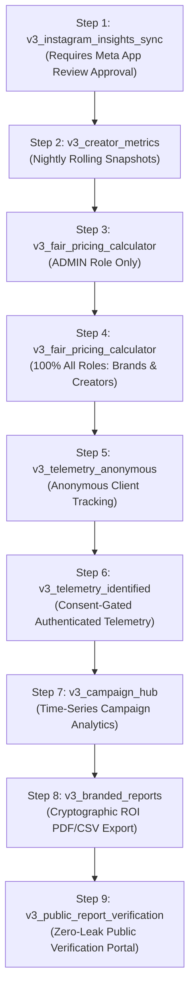

# 📋 VyaparMedia V3 Staged Rollout, QA Script & Production Release Checklist

> **Version**: 3.0.0-GA  
> **Target Release Window**: November 2026  
> **Status**: Ready for Production Staged Deployment  
> **Compliance Anchors**: DPDP Act 2023, IT Act 2000 Section 65B, GST SAC 998361, Meta App Review v21.0  

---

## 1. Staged Feature Flag Rollout Plan

All features in V3 are isolated behind fail-closed feature flags (`FeatureFlag` entity). Flags are evaluated with Redis caching (`TTL 60s`) and default to disabled (`false`) upon Redis or database failure.



### Stage-by-Stage Rollout Sequence

| Stage | Feature Flag Key | Target Audience | Pre-Condition / Prerequisite | Gate Criteria |
|:---:|:---|:---|:---|:---|
| **1** | `v3_instagram_insights_sync` | Internal Workers | Meta App Review approved for `instagram_manage_insights`, `pages_read_engagement` | Zero Meta Graph 400/403 token rejection errors in Sentry for 24h. |
| **2** | `v3_creator_metrics` | Background Crons | QStash schedule `0 2 * * *` registered and healthy | At least 1 complete nightly snapshot run without database timeouts. |
| **3** | `v3_fair_pricing_calculator` | `ADMIN` Role Only | Category benchmarks populated in `CategoryBenchmark` | Admin manual sanity check of floor/target/ceiling rates across 5 niches. |
| **4** | `v3_fair_pricing_calculator` | 100% All Roles | Admin approval of calibration results | Pricing read latency p95 < 50ms (Redis cache hit rate > 80%). |
| **5** | `v3_telemetry_anonymous` | 100% Anonymous Visitors | `TELEMETRY_DAILY_SALT_SECRET` set in environment | Redis stream ingestion rate p95 < 50ms under 200 RPS burst. |
| **6** | `v3_telemetry_identified` | Opted-in Authenticated Users | User consent banner active on `/dashboard/settings` | Affirmative consent checks pass with 0 unconsented events stored. |
| **7** | `v3_campaign_hub` | Brands & Creators | Campaign daily aggregation crons active | Dashboard server render latency < 1.2s on seeded campaigns. |
| **8** | `v3_branded_reports` | Brands & Creators | `REPORT_VERIFICATION_HMAC_SECRET` set in environment | CSV export formula injection test passes; PDF rendering complete. |
| **9** | `v3_public_report_verification`| Public Web (`/verify-report/*`) | Report generation active and signing keys verified | Zero PII or private financial terms exposed on public route. |

---

## 2. Rollback Procedure per Flag

If an anomaly, regression, or external API error occurs at any stage, execute the targeted rollback immediately without redeploying code:

### 2.1 Quick-Kill via Admin UI
Navigate to **`/admin/system`** ➔ **Feature Flags Console** ➔ Locate the affected flag ➔ Toggle **Disabled** ➔ Click **Update Flag**.  
*(Changes take effect across all serverless instances within 60 seconds).*

### 2.2 Instant Rollback via PostgreSQL / CLI
Run the following SQL statement via Supabase SQL Editor or `psql`:

```sql
-- Immediate hard-disable of a specific feature flag
UPDATE "FeatureFlag"
SET "isEnabled" = false,
    "rolloutPercentage" = 0,
    "updatedAt" = NOW()
WHERE "key" = 'v3_telemetry_anonymous';

-- Evict the cached flag state from Redis
-- (Executed via redis-cli or Upstash REST console)
DEL "feature_flag:v3_telemetry_anonymous"
```

### 2.3 Rollback Impact Matrix

| Flag Rolled Back | User Impact | System Behavior | Data Loss Risk |
|:---|:---|:---|:---:|
| `v3_instagram_insights_sync` | Creator profiles display historical or self-reported metrics | Meta Graph sync halts; token refresh suspends | **Zero** |
| `v3_creator_metrics` | Creator analytics snapshot pauses | Historical snapshots remain available | **Zero** |
| `v3_fair_pricing_calculator` | Campaign creation form hides fair-rate guidance cards | Users enter custom bid rates manually | **Zero** |
| `v3_telemetry_anonymous` | Ingest endpoint returns 200 with `{ tracked: false }` | No client event buffering or rollup | **Zero** |
| `v3_telemetry_identified` | Authenticated events bypass ingest | Only anonymous aggregate counters run | **Zero** |
| `v3_campaign_hub` | Campaign analytics tab redirects to campaign overview | Deal workroom continues operating normally | **Zero** |
| `v3_branded_reports` | Report export buttons render fallback legacy statements | Standard statement downloads remain available | **Zero** |
| `v3_public_report_verification`| `/verify-report/[code]` returns "Service Temporarily Inactive" | Existing reports remain legally valid | **Zero** |

---

## 3. Manual Role-Based QA Scripts

### 3.1 Creator Role QA Script
1. **Login & Profile Verification**:
   - Log in as test creator: `creator_qa@vyaparmedia.test` / `TestPass123!`.
   - Navigate to `/creator/creator_qa` (public profile).
   - Verify that **"VERIFIED"** or **"SELF_REPORTED"** badges appear next to follower counts and engagement rate.
   - Confirm zero PII (email, phone, bank account) is exposed in page source.
2. **Rates Guidance Card**:
   - Navigate to `/dashboard/settings` ➔ **Rates Tab**.
   - Verify that `MarketRangeCard` renders floor, target, and ceiling rates formatted in `₹` with `font-mono tabular-nums`.
   - Update niche or followers and verify that guidance calculates dynamically without page reload.
3. **Telemetry Consent Toggle**:
   - Navigate to `/dashboard/settings` ➔ **Security & Privacy Tab**.
   - Toggle "Allow anonymous analytics" **OFF** ➔ Save.
   - Trigger a page navigation. Verify in network inspector that `/api/telemetry/track` is either not called or rejected server-side.
   - Toggle **ON** ➔ Verify consent mutation succeeds.

### 3.2 Brand Role QA Script
1. **Campaign Creation with Fair Price Guidance**:
   - Log in as test brand: `brand_qa@vyaparmedia.test` / `TestPass123!`.
   - Navigate to `/dashboard/campaigns/create`.
   - Select Category: `Fashion & Beauty`, Deliverable: `Instagram Reel × 1`.
   - Verify that Fair-Price Guidance badge appears showing target benchmark (e.g., `₹5,000 – ₹7,500`).
   - Enter proposed rate below floor ➔ Confirm inline non-blocking warning: *"Below estimated market floor"*.
2. **Campaign Hub & Real-Time Pacing**:
   - Navigate to `/dashboard/campaigns/[id]/analytics` for an active campaign.
   - Verify time-series chart renders impressions, engagement, and reach without layout shifts.
   - Check that numbers carry `VERIFIED` (Meta API) or `ESTIMATED` badges.
3. **Branded Report Generation & Download**:
   - Navigate to `/dashboard/campaigns/[id]/roi`.
   - Click **Download Verified ROI Report (PDF)** and **Export CSV**.
   - Open CSV file in Excel/text editor:
     - Verify no cell begins with unescaped `=`, `+`, `-`, `@` (`csvEsc` defense).
     - Verify verification code `REP-XXXX-YYYY` is printed in header metadata.

### 3.3 Admin Role QA Script
1. **Cron Health Heartbeat Console**:
   - Log in as active administrator (`requireActiveAdmin`).
   - Navigate to `/admin/system`.
   - Inspect **Cron Heartbeats Card**: Verify all 21 crons list last execution time in `Asia/Kolkata` (IST), status badges (`HEALTHY` / `DEGRADED`), and execution durations.
2. **Feature Flag Manager**:
   - Toggle a non-critical flag (e.g. `v3_advanced_traffic_analytics`) from ON to OFF.
   - Verify toast confirmation appears.
   - Refresh the page and confirm state persists.
3. **Traffic & Funnel Analytics**:
   - Navigate to `/admin/analytics` ➔ Select **Traffic** tab.
   - Verify device breakdown, browser share, and conversion drop-off bars render with accurate percentages.

---

## 4. 7-Day Production Observability Watchlist

Monitor the following Prometheus metrics and logs continuously during the initial 7-day rollout:

| Metric Name | Threshold Alert | Severity | Remediation Action |
|:---|:---:|:---:|:---|
| `VyaparMedia_telemetry_events_dropped_total{reason="rate_limit"}` | `> 50 / min` | Warning | Inspect source IP; adjust `TELEMETRY_INGEST` rate limit bucket if genuine burst. |
| `VyaparMedia_telemetry_events_dropped_total{reason="schema_error"}` | `> 5 / min` | Error | Client-side bundle mismatch; check for outdated client builds emitting old payloads. |
| `VyaparMedia_telemetry_flush_duration_ms` | `p95 > 500 ms` | Warning | Check Postgres write IOPS during 5-minute cron batch flush. |
| `VyaparMedia_fair_price_compute_duration_ms` | `p95 > 100 ms` | Warning | Verify Redis benchmark caching; check for cold-cache thrashing. |
| `VyaparMedia_instagram_insights_requests_total{status="error"}` | `> 5 / hour` | High | Check for expired Meta user tokens; verify `/api/cron/refresh-social-tokens` health. |
| `VyaparMedia_cron_job_runs_total{status="FAILED"}` | `> 0` | Critical | Immediate inspection of failing job in `/admin/system` or Sentry trace. |
| `PostgreSQL Active Connection Pool` | `> 80% capacity` | High | Verify PgBouncer connection pooling and zero unreleased Prisma connections. |
